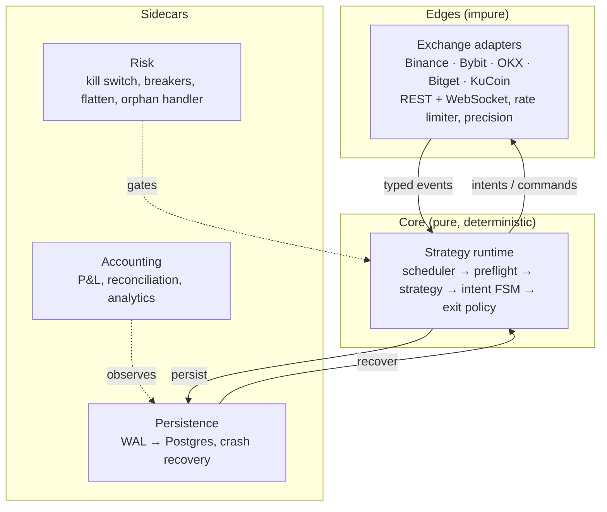

# funding-rate-engine

[](https://github.com/nicolasMazuryk/funding-rate-engine/actions/workflows/ci.yml)
[](LICENSE)

Crash-safe, event-driven perpetual-futures funding-rate engine: hexagonal core, write-ahead-log recovery, kill-switch and deterministic replay tests.

## The problem

Perpetual futures pay (or charge) a funding rate every few hours. Harvesting it means entering around the settlement time, holding through it and exiting cleanly, on venues that each have their own order semantics, precision rules and failure modes. A bug here costs real money, so the engine is built so that:

- the strategy logic is **deterministic**: the same event stream and config always produce the same decisions, so any run can be replayed and compared with a golden trace;
- a crash never loses an intent: state is written to a local **write-ahead log** and recovered at boot;
- a **kill switch**, circuit breakers and a flatten path stop trading on their own when something looks wrong;
- configuration **fails loud** at startup, before any order is sent.

One running instance is one exchange, one strategy and one sub-account.

## Architecture



The core depends only on ports (interfaces). It imports no exchange client, database driver or socket library, and an import-boundary lint enforces that. Details and the enforcement map are in [docs/architecture.md](docs/architecture.md).

## Stack

TypeScript (strict) on Node 24 with native type stripping, [ccxt](https://github.com/ccxt/ccxt) and the native venue SDKs, Zod for config validation, Drizzle ORM on Postgres, pino, [Biome](https://biomejs.dev) for lint and format, and Vitest.

## Getting started

Requires Node 24 (see `.nvmrc`).

```bash
npm ci
npm run verify      # typecheck + biome + unit tests (no credentials, no network)

# replay a recorded trace through the core and compare it with its golden file
npm run replay -- test/golden/fixtures/skeleton.trace.golden.jsonl \
  --expect test/golden/fixtures/skeleton.trace.golden.jsonl
```

To boot an instance, copy `.env.example` to `.env` and fill in the instance identity and the credentials of the selected venue, then run `npm start`. Integration tests need Postgres (`docker compose up -d`, then `npm run test:integration`). The testnet and live tiers talk to real venues and are run by hand; the live tier places real orders with hard notional caps and must only be run on a funded sub-account you control.

## Layout

```
src/
  core/         pure strategy runtime: events, ports, intent FSM, sizing, strategies
  adapters/     exchange adapters (impure edge) and the simulated venue
  execution/    order manager, order FSM, position and funding trackers
  risk/         kill switch, circuit breakers, flatten, orphan handler
  persistence/  WAL, Postgres/Drizzle projector, crash recovery
  accounting/   P&L sidecar, reconciliation
  analytics/    read-only trade analytics and fleet rollup
  replay/       deterministic trace replay
  config/       .env + YAML, Zod schemas, fail-loud startup
test/           unit, integration, e2e, golden traces, recorded venue fixtures
docs/           specs, architecture, plan and task ledger
```

## Design decisions

The system is specified in [docs/specs/](docs/specs/) (strategies `01`–`07`, system `08`–`17`). The decisions that shape the code:

- **Pure core, mess at the edges.** Everything the strategy decides is a function of its event stream, so tests need no credentials and runs are replayable. See [docs/architecture.md](docs/architecture.md).
- **Funding settlement is a first-class event**, not a bolt-on to a polling loop.
- **One FSM engine** drives both intents and orders; one adapter interface covers all venues.
- **Biome instead of ESLint + Prettier**, one tool for lint and format.
- **Layered verification:** unit and simulated-venue e2e tests, recorded-fixture tests, testnet, then a capped real-money live tier that always tears down flat.
- Binding planning decisions and resolved spec ambiguities are recorded in [ROADMAP §3](docs/plan/ROADMAP.md#3-binding-decisions--assumptions).

## Roadmap and limitations

The build is split into 53 tasks across 9 phases; [docs/plan/ROADMAP.md](docs/plan/ROADMAP.md) has the phases and milestones, [docs/plan/STATUS.md](docs/plan/STATUS.md) the task ledger and open deferrals.

Known limitations:

- `max_daily_loss_usd` is parsed but not yet enforced.
- Reconciliation does not yet cover the balance dimension.
- Some analytics metrics return `insufficient_data` until the remaining capture work lands.
- Strategy 6 (pre-funding entry) is still being validated through shadow and canary runs.
- Config values in `config/*.yaml` are proposals, not tuned production values.
- Gate.io was deliberately skipped.

This is a trading system that can lose money. It is published as an engineering showcase, not as financial advice.

## License

[MIT](LICENSE)
